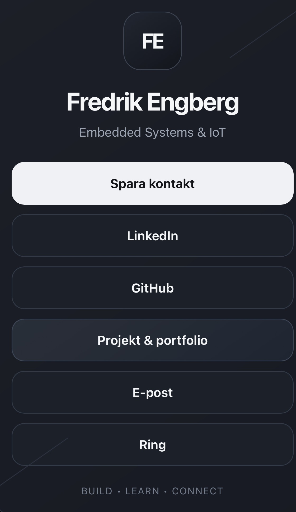
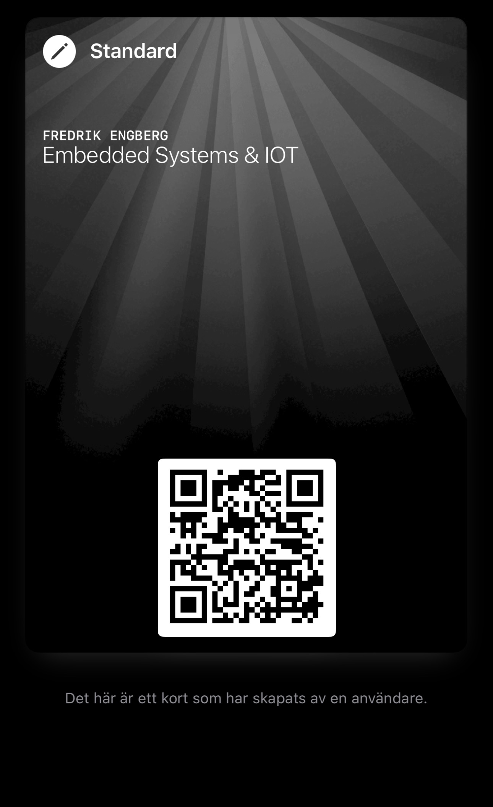

# Fredrik Engberg – Connect

En enkel digital kontaktsida byggd med HTML/CSS och publicerad kostnadsfritt via GitHub Pages.

Sidan är framtagen för nätverkande, branschdagar, mässor och andra tillfällen där kontaktuppgifter snabbt ska kunna delas via QR-kod.

## Live-sida

**Connect:**  
https://fredrikengberg.github.io

**Projekt & portfolio:**  
https://fredrikengberg.github.io/portfolio.html

---

## Så fungerar det

QR-koden öppnar Connect-sidan direkt i mobilen.

Där kan besökaren:

- spara kontaktuppgifterna
- öppna LinkedIn
- öppna GitHub
- gå vidare till projekt och portfolio
- skicka e-post
- ringa

QR-koden kan även sparas i Apple Wallet för snabb åtkomst vid exempelvis branschdagar och nätverksträffar.

### Connect-sidan

<p align="center">
  
</p>

### Apple Wallet

<p align="center">
  
</p>

---

## Funktioner

- Digitalt kontaktkort
- Spara kontakt som vCard (`.vcf`)
- LinkedIn
- GitHub
- Projekt & portfolio
- E-post
- Telefonsamtal
- Mobilanpassad design
- QR-kod som leder direkt till kontaktsidan
- Apple Wallet för snabb åtkomst
- GitHub Pages-hosting
- Responsiv design

---

## Filstruktur

```text
fredrikengberg.github.io/
│
├── index.html
├── portfolio.html
├── contact.vcf
├── README.md
│
└── assets/
    ├── connect-preview.jpeg
    └── wallet-preview.jpeg
```

### `index.html`

Innehåller själva Connect-sidan och länkar till:

- vCard
- LinkedIn
- GitHub
- Projekt & portfolio
- e-post
- telefon

### `portfolio.html`

Innehåller projekt- och portfoliosidan.

Sidan kan successivt byggas ut med projekt inom exempelvis:

- Embedded Systems
- IoT
- C/C++
- Java
- ESP32
- automation
- Home Assistant
- egna teknikprojekt

### `contact.vcf`

vCard-filen innehåller kontaktinformationen som kan sparas direkt i telefonens kontaktbok.

Exempel:

```text
BEGIN:VCARD
VERSION:3.0
FN:Förnamn Efternamn
N:Efternamn;Förnamn;;;
TITLE:Embedded Systems & IoT
TEL;TYPE=CELL:+46XXXXXXXXX
EMAIL;TYPE=INTERNET:namn@example.com
URL:https://username.github.io
URL:https://www.linkedin.com/in/username/
URL:https://github.com/username
END:VCARD
```

---

# Skapa en egen Connect-sida

## 1. Skapa ett GitHub-repository

Skapa ett nytt publikt repository med namnet:

```text
dittgithubnamn.github.io
```

Exempel:

```text
fredrikengberg.github.io
```

Repositoryt ska ha samma namn som ditt GitHub-användarnamn följt av `.github.io`.

---

## 2. Skapa `index.html`

Skapa filen:

```text
index.html
```

Lägg in HTML och CSS för kontaktsidan.

Exempel på länkar:

```html
<a href="contact.vcf">
  Spara kontakt
</a>

<a href="https://www.linkedin.com/in/USERNAME/">
  LinkedIn
</a>

<a href="https://github.com/USERNAME">
  GitHub
</a>

<a href="portfolio.html">
  Projekt & portfolio
</a>

<a href="mailto:namn@example.com">
  E-post
</a>

<a href="tel:+46XXXXXXXXX">
  Ring
</a>
```

---

## 3. Skapa vCard

Skapa filen:

```text
contact.vcf
```

Lägg in namn, telefonnummer, e-postadress och relevanta länkar.

Knappen **Spara kontakt** i `index.html` ska länka till:

```html
href="contact.vcf"
```

När filen öppnas på en kompatibel telefon kan användaren lägga till kontaktuppgifterna direkt i kontaktboken.

---

## 4. Aktivera GitHub Pages

Öppna repositoryt och gå till:

```text
Settings
→ Pages
```

Under **Build and deployment**:

```text
Source: Deploy from a branch
Branch: main
Folder: / (root)
```

Spara inställningen.

Sidan blir därefter tillgänglig på:

```text
https://dittgithubnamn.github.io
```

---

## 5. Testa sidan

Testa framför allt från mobiltelefon.

Kontrollera att:

- Spara kontakt fungerar
- LinkedIn öppnas korrekt
- GitHub öppnas korrekt
- Projekt & portfolio öppnas korrekt
- E-post öppnar standardappen för e-post
- Ring öppnar telefonfunktionen
- sidan fungerar på både liten och stor skärm

---

## 6. Skapa QR-kod

Skapa en QR-kod som endast innehåller webbadressen:

```text
https://dittgithubnamn.github.io
```

Lägg inte telefonnummer, e-post och andra kontaktuppgifter direkt i QR-koden.

Fördelen är att innehållet på webbsidan kan ändras senare utan att QR-koden behöver bytas.

Flödet blir:

```text
QR-kod
   ↓
Connect-sida
   ↓
Spara kontakt
LinkedIn
GitHub
Portfolio
E-post
Telefon
```

---

## 7. Lägg QR-koden i Apple Wallet

QR-koden kan läggas till i Apple Wallet för snabb åtkomst från telefonen.

Det gör lösningen praktisk vid exempelvis:

- branschdagar
- mässor
- intervjuer
- LIA-kontakter
- nätverksträffar

Den andra personen skannar QR-koden och får direkt tillgång till Connect-sidan.

```text
Apple Wallet
     ↓
QR-kod
     ↓
Connect-sida
     ↓
Kontakt & professionella profiler
```

---

## Valfritt – profilbild

En profilbild kan läggas på Connect-sidan och även inkluderas i vCard-filen.

Det gör det enklare för en ny kontakt att komma ihåg vem personen var efter exempelvis en branschdag eller nätverksträff.

---

## Valfritt – egen domän

GitHub Pages kan senare kopplas till en egen domän, exempelvis:

```text
namn.se
```

QR-koden kan då exempelvis leda till:

```text
https://namn.se
```

GitHub Pages kan fortfarande användas som hosting i bakgrunden.

---

## Säkerhet och integritet

GitHub Pages och filer i ett publikt repository är offentliga.

Information som placeras i exempelvis:

```text
contact.vcf
```

kan därför läsas av andra.

Publicera endast telefonnummer, e-postadress och annan information som är avsedd att vara offentlig.

---

## Teknik

- HTML5
- CSS3
- Responsive Web Design
- vCard 3.0
- GitHub
- GitHub Pages
- QR-kod
- Apple Wallet

---

## Syfte

Projektet skapades som en enkel och professionell lösning för att snabbt kunna dela kontaktuppgifter och professionella profiler vid nätverkande.

Lösningen är byggd så att innehållet kan utvecklas och ändras över tid utan att själva QR-koden behöver bytas.

Det gör samma QR-kod användbar även när nya projekt, kontaktuppgifter eller funktioner läggs till.

---

<p align="center">
  <strong>BUILD • LEARN • CONNECT</strong>
</p>
